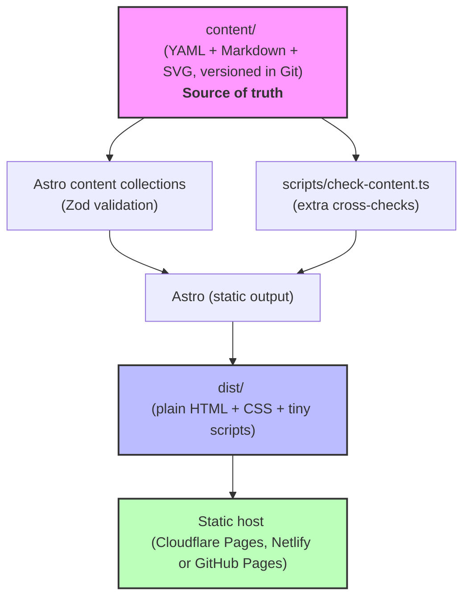

# Le Petit Vitruve (lepetitvitruve.fr)

A **visual reference for architecture vocabulary**: one page per element, each pairing a plain-language description with a simple annotated diagram, so a reader can match a word to what they're looking at.

Example page: `/fenetre-serlienne` shows the name, aliases (*fenêtre vénitienne*), and an annotated SVG diagram next to a description of what the element looks like and how to recognize it.

The site is **fully static and framework-free on the client**: content is validated at build time and turned into plain HTML, and the only JavaScript is a couple of small vanilla scripts. There is no backend, no database, no React, no MDX, and no photos stored in the repository.

---

## 1. Architecture at a glance



## 2. Repository layout (V1)

```
.
├── AGENTS.md
├── EDITORIAL_GUIDELINES_fr.md      # French writing rules for fr.md (structure, definitions, links)
├── README.md
├── ROADMAP.md
├── GRAPHICS_GUIDELINES.md    # visual spec of vector graphics
├── DESIGN_GUIDELINES.md      # visual and structural spec
├── package.json
├── astro.config.mjs
├── tsconfig.json
├── .github/workflows/ci.yml
├── content/
│   └── elements/
│       └── serlian-window/
│           ├── annotation.yaml        # localized name, slug, aliases, tags, gender, optional parts
│           ├── fr.md               # plain Markdown, no front matter
│           ├── preview.svg         # optional compact drawing
│           └── full.svg            # optional annotated drawing
├── scripts/
│   └── check-content.ts            # cross-checks Zod cannot express (read-only)
├── public/                         # favicon, robots.txt
└── src/
    ├── content.config.ts           # collection + Zod schema
    ├── layouts/BaseLayout.astro    # <html lang="fr">, SEO head, header/footer
    ├── components/                 # SiteHeader, SiteFooter, TitleRow,
    │                               # DiagramCard, AnnotationsCard, MarkdownCard, SeoHead
    ├── views/ElementView.astro
    ├── pages/
    │   ├── index.astro             # the unfiltered index of all entries
    │   └── [slug].astro            # element pages
    ├── scripts/                    # diagram.ts (vanilla)
    ├── styles/                     # tokens.css, base.css, element.css
    └── lib/                        # content queries, slugs, seo
```

There is no `content/buildings/`, no `src/pages/en/`, no `src/pages/etiquette/`, no `src/pages/batiment/`, no `src/pages/recherche.astro`, and no `glossary-filter.ts`. These arrive with V2 and V3. `content/tags/<group>/<name>.yaml` only holds tag definitions (label, optional chip color) used by the annotations card.

---

## 3. Content model (V1)

### 3.1. Tag

A tag is a label that can be attached to an element to indicate its style, region, artistic intention, or other classification. `content/tags/<group>/<name>.yaml` is the single source of truth: an element's `tags` field is a list of tag keys, and every key must match a tag file (`check:content` enforces it). Each tag file carries French (`fr`) and English (`en`) texts.

```yaml
key: mood/cozy
slug: { fr: intime, en: cozy }
label: { fr: Intime, en: Cozy }
color: "#f8e1c8"           # optional light chip background; default is light gray
description:
  fr: "..."
  en: "..."
```

The element page's annotations card (below the diagram) lists an element's tags as French-labelled chips, grouped by tag group (Catégorie = `category`, Style, Période, Région, Sentiment = `mood`, Rarité = `rarity`, Partie = `part`; see `GROUP_TITLES` in `src/lib/annotations.ts`). A tag file's `key` must equal its path (`style/baroque` for `content/tags/style/baroque.yaml`). Slugs must be unique within a group, per language.


### 3.2. Element

`content/elements/serlian-window/annotation.yaml`:

```yaml
name:
  fr: Fenêtre serlienne
  en: Serlian window
gender:
  fr: n.f.                    # Le Robert notation: n.m. | n.f.
slug:
  fr: fenetre-serlienne
  en: serlian-window
aliases:
  fr:
    - fenêtre vénitienne
    - fenêtre palladienne
  en:
    - Venetian window
    - Palladian window
category: opening             # opening | support | roof | ornament | structure
tags:
  - style/classical
  - region/europe   # keys of content/tags/ files
parts: []
```

Names, slugs and aliases use the `{ fr, en }` shape; `tags` is a language-neutral list of tag keys. `gender` is French only (`gender.fr`) and gives the part of speech and grammatical gender in the Le Robert dictionary notation: `n.m.` (nom masculin) or `n.f.` (nom féminin). It is required on every element and is shown just after the title on the element's page, in muted italic. The collection folder supplies the stable technical `id`; it is not duplicated in YAML. `parts` is optional and describes annotated regions when a `full.svg` exists. `category` only drives the header icon on the entry's own page.

`fr.md` is plain Markdown, no front matter, no comment markers. Its structure and writing rules are in `EDITORIAL_GUIDELINES_fr.md`:

```md
# Fenêtre serlienne

## Définition
Ouverture composée de trois baies, la centrale en plein cintre et plus large que les deux latérales...

Il ne faut pas la confondre avec la fenêtre en baie, ...

## Rôle
...

## Exemples
- [Palais Farnèse, Rome, Italie](https://maps.app.goo.gl/...)
- Villa ..., Vicence, Italie
```

Definitions open with a noun phrase, not "C'est un…". `## Rôle` and `## Exemples` are required; `## Caractéristiques` and `## Trivia` are optional. Bullets, external links and emphasis are restricted as set out in the guidelines.

`##` headings render as real headings; everything else renders through ordinary Markdown rules. The French file is named `fr.md`; V2 may add `en.md` next to it and turn on locale routing.

---

## 4. Validation

Two layers, both run in `npm run build` and in CI:

1. **Astro content collections (Zod).** Field types on `annotation.yaml` (`name`, `gender`, `slug`, `aliases`, `tags`, `category`, and optional `parts`); `gender.fr` must be `n.m.` or `n.f.`. The folder supplies `id`.
2. **`scripts/check-content.ts`.** What a schema cannot express:
   - `slug.fr` is lowercase ASCII kebab-case, unique across entries, and does not collide with a reserved route (`index`, `about`, `404`, `sitemap`)
   - every entry in `tags` has a matching file in `content/tags/`, with no duplicates; every tag file's `key` matches its path, its group is known, and its slugs are unique within the group
   - `parts` ids are unique
  - every `parts[].id` exists as `data-part` in an annotated SVG, and vice versa
   - marker coordinates fall inside the SVG `viewBox`, and no two markers are closer than twice the touch-target radius
  - SVG rules: optional `preview.svg`/`full.svg`, no `<text>`, no scripts, no external references, no hard-coded hex colors, and no theme rules of their own. Colors come from CSS variables; light/dark values are defined only in `src/styles/tokens.css` (`check:content` rejects any `prefers-color-scheme` in an SVG)
   - `fr.md` is non-empty and starts with an `h1`

Errors name the file and the field, and the build stops.

---

## 5. Routing

Single locale, flat routes, generated by `getStaticPaths` from `content/elements/`:

| Page | Route |
|---|---|
| Index (all entries) | `/` |
| Element | `/fenetre-serlienne/` |

URLs end with a trailing slash (`trailingSlash: 'always'`) so the canonical URL, the sitemap and the static host all agree. No aliasing routes, no redirects, no `hreflang`, no sitemap alternates — there's only one URL per entry and one language. `astro.config.mjs` declares the `fr`/`en` i18n locales with French unprefixed, but no English route exists yet.

